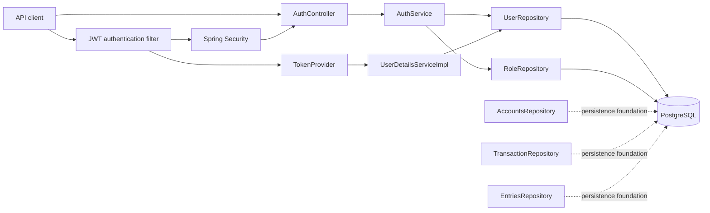
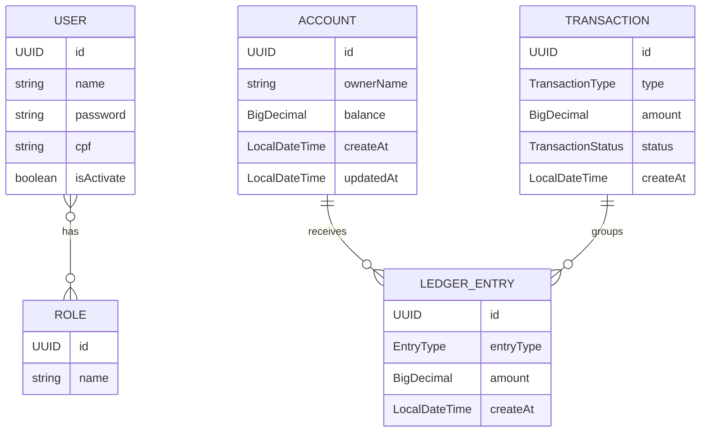

<p align="center">
  
</p>

<h1 align="center">LedgerCore</h1>

<p align="center">
  <strong>Exploring reliable financial transactions, data consistency and backend engineering with Java.</strong>
</p>

<p align="center">
  
  
  
  
  
</p>

LedgerCore is a portfolio and study project focused on the engineering behind a financial transaction engine. Its goal is not to reproduce an entire digital bank, but to evolve a small backend core while investigating what makes monetary operations consistent, traceable and reliable.

> [!IMPORTANT]
> LedgerCore is under active development and is not ready for production or for handling real money. The current repository contains authentication and persistence foundations; account operations, deposits and transfers are not implemented yet.

## Contents

- [Overview](#overview)
- [Current project status](#current-project-status)
- [Core engineering challenges](#core-engineering-challenges)
- [Architecture](#architecture)
- [Domain model](#domain-model)
- [Technology stack](#technology-stack)
- [API documentation](#api-documentation)
- [Database and consistency](#database-and-consistency)
- [Getting started](#getting-started)
- [Testing strategy](#testing-strategy)
- [Engineering decisions](#engineering-decisions)
- [Roadmap](#roadmap)

## Overview

A financial operation is more than a balance update. A transfer, for example, requires the debit and credit to behave as one unit, must not spend the same funds twice under concurrent requests, must not be duplicated when a client retries, and must leave enough evidence to explain every balance change.

LedgerCore uses that problem space to study:

- transaction boundaries and atomic persistence;
- financial data modeling and double-entry bookkeeping;
- consistency rules and database integrity;
- concurrency control and race-condition prevention;
- idempotent request processing;
- auditable transaction history;
- unit, web-layer and integration testing;
- eventually, asynchronous processing and distributed consistency patterns.

These are project goals, not claims about the current implementation. The sections below identify the present state explicitly.

## Current project status

Status definitions used throughout this document:

| Status | Meaning |
| --- | --- |
| **Implemented** | The building block exists in the repository and can be verified in code. |
| **In progress** | Part of the design exists, but the end-to-end behavior is incomplete or still needs hardening. |
| **Planned** | It is part of the intended evolution and has not been implemented. |

### Implemented foundations

- Spring Boot application bootstrap and Maven build.
- JPA entities for users, roles, accounts, transactions and ledger entries.
- Spring Data repositories for all current entities.
- Stateless Spring Security configuration, JWT creation/validation and BCrypt password hashing.
- Controller routes for user registration, login and token refresh.
- Centralized exception response type and exception handler.
- OpenAPI/Swagger UI dependency.
- H2-backed Spring context test, controller unit tests and `AccountEntity` unit tests.

### In progress

- Authentication flow hardening, request validation and authorization rules.
- Financial domain mapping: entities and repositories exist, but no financial use cases orchestrate them.
- Ledger modeling: entry types and relationships exist, but no posting rules or balancing invariant are enforced.
- API documentation exposure: springdoc is installed, but the documentation routes are currently protected by the security catch-all rule.

### Planned features

- Account creation and lookup.
- Deposits and account balance updates.
- Transfers between accounts.
- Transaction and ledger-entry history queries.
- Atomic posting of financial operations.
- Double-entry balancing rules.
- Concurrency control, locking and overspending prevention.
- Idempotency keys and safe request retries.
- Integration, rollback and concurrent-execution tests.
- Asynchronous processing, transactional outbox and observability where they add value.

## Core engineering challenges

| Challenge | Why it matters | Current state |
| --- | --- | --- |
| **Transaction atomicity** | A transfer must persist its debit and credit together or persist neither. | **Planned.** No financial service or `@Transactional` boundary exists yet. |
| **Data consistency** | Amounts, balances, states and relationships must always obey explicit financial invariants. | **In progress.** JPA nullability, relationship and uniqueness constraints provide a starting point; monetary invariants are not enforced. |
| **Concurrency control** | Simultaneous requests must not read the same balance and both spend funds that only one request can use. | **Planned.** There is no optimistic/pessimistic locking or tested concurrency strategy. |
| **Idempotency** | Retrying the same deposit or transfer must not create a second financial operation. | **Planned.** No idempotency key or uniqueness policy exists. |
| **Auditability** | The system should explain which operation produced each debit or credit and when it happened. | **In progress.** Transaction and ledger-entry entities are modeled, but no posting or history API exists. |

A database transaction will eventually be necessary for a transfer, but it is not sufficient by itself: transaction isolation, locking, retries, uniqueness constraints and application invariants must also be designed and tested.

## Architecture

The project follows a layered Spring application structure. The currently executable application flow is centered on authentication:



| Layer | Current responsibility |
| --- | --- |
| `controller` | Exposes the authentication HTTP contract and delegates behavior to the service. |
| `service` | Registers users, authenticates credentials, issues tokens and loads security principals. There are no account or transaction services yet. |
| `database.repository` | Provides Spring Data JPA persistence interfaces for users, roles and the financial domain entities. |
| `database.model` | Defines the relational model and entity relationships. |
| `config` | Configures stateless security, the JWT filter, token operations, password encoding and authentication management. |
| `handler` | Converts selected exceptions into a consistent `{ message, code }` response. |

The intended financial flow is `Client → Controller → Service → Repository → PostgreSQL`. At present, only the repository and domain-model portions of that flow exist for accounts, transactions and entries.

## Domain model



### Financial entities

| Entity | Implemented fields and relationships | Status |
| --- | --- | --- |
| `AccountEntity` (`accounts`) | UUID identifier, owner name, `BigDecimal` balance defaulting to zero, creation/update timestamps and a lazy one-to-many entry collection. | **In progress** |
| `TransactionEntity` (`transactions`) | UUID identifier, type (`DEPOSIT` or `TRANSFER`), amount, status (`PENDING`, `COMPLETED` or `FAILED`), creation timestamp and a lazy one-to-many entry collection. | **In progress** |
| `EntrieEntity` (`ledger_entries`) | UUID identifier, owning account, owning transaction, entry type (`DEBIT` or `CREDIT`), amount and creation timestamp. | **In progress** |

`EntrieEntity` is the current Java class name; its database table is `ledger_entries`. The model expresses the intended association between an account, a transaction and its entries. It does **not** yet guarantee that every transaction produces balanced debits and credits, and no application service currently creates these records.

### Security entities

- `UserEntity` stores a UUID, name, BCrypt-compatible password field, unique CPF identifier, active flag and eagerly loaded roles.
- `RoleEntity` implements Spring Security's `GrantedAuthority` and has a unique role name.
- Users and roles are connected through the `user_roles` many-to-many join table.
- There is currently no relationship between `UserEntity` and `AccountEntity`.

## Technology stack

| Technology | Version or scope | Purpose |
| --- | --- | --- |
| Java | 21 | Language level configured by Maven. |
| Spring Boot | 4.1.1 | Application bootstrap and dependency management. |
| Spring Web MVC | Managed by Spring Boot | REST controllers and HTTP handling. |
| Spring Data JPA | Managed by Spring Boot | Entity persistence and repository abstraction. |
| Spring Security | Managed by Spring Boot | Stateless authentication and route protection. |
| Spring Validation | Managed by Spring Boot | Bean Validation annotations; controller-level enforcement still needs completion. |
| PostgreSQL | Runtime driver | Primary local/runtime relational database. |
| H2 | Test scope | Isolated database used when loading the Spring test context. |
| JJWT | 0.13.0 | JWT generation, signature verification and claim parsing. |
| springdoc-openapi | 3.1.0 | Runtime OpenAPI document and Swagger UI generation. |
| Lombok | Managed by Spring Boot | Builders, constructors and accessor generation. |
| JUnit 5, Mockito, AssertJ and MockMvc | Test scope | Context, entity and controller tests. |
| Maven | Project build tool | Dependency resolution, compilation, tests and application execution. |

Docker and Docker Compose are not currently part of the repository.

## API documentation

### Implemented HTTP routes

| Method | Endpoint | Description | Status |
| --- | --- | --- | --- |
| `POST` | `/v1/auth/register` | Persists a new user and returns an empty response with `201 Created`. | **In progress** |
| `POST` | `/v1/auth/login` | Authenticates CPF/password credentials and returns a signed JWT. | **In progress** |
| `POST` | `/v1/auth/refresh` | Creates a new token from the current `Authentication`. | **In progress** |

All `/v1/auth/**` routes are currently permitted by the security configuration. This also includes the refresh endpoint, even though it expects an authenticated principal; calling it without a valid principal can fail. Request DTO constraints are present on registration fields, but `@Valid` is not currently applied by the controller, so those constraints are not yet enforced at the HTTP boundary.

The registration service also still needs correction before it can be considered complete: its duplicate-user lookup currently receives the password instead of the CPF, and its fallback role creation searches for `ROLE_USER` but creates `ROLE_ADMIN`. These are known implementation gaps, which is why the authentication routes are marked **In progress**.

#### Register a user

```http
POST /v1/auth/register
Content-Type: application/json

{
  "name": "Ada Lovelace",
  "password": "change-this-password",
  "cpf": "00011122233"
}
```

Current success response: `201 Created` with an empty body.

#### Log in

```http
POST /v1/auth/login
Content-Type: application/json

{
  "cpf": "00011122233",
  "password": "change-this-password"
}
```

```json
{
  "token": "<signed-jwt>",
  "expirationTime": 900000
}
```

#### Refresh a token

```http
POST /v1/auth/refresh
Authorization: Bearer <signed-jwt>
```

```json
{
  "token": "<new-signed-jwt>",
  "expirationTime": 900000
}
```

The global handler represents handled application errors as:

```json
{
  "message": "<error description>",
  "code": 400
}
```

The code currently maps bad requests to `400`, missing users to `404`, unhandled exceptions to `500`, unauthenticated access to `401`, and denied authenticated access to `403`. These are implementation mappings, not a complete stabilized API error contract.

### Planned financial routes

The following routes describe the initial product scope, but no matching controllers exist yet:

| Method | Intended endpoint | Intended responsibility | Status |
| --- | --- | --- | --- |
| `POST` | `/accounts` | Create an account. | **Planned** |
| `GET` | `/accounts/{id}` | Retrieve an account. | **Planned** |
| `POST` | `/accounts/{id}/deposit` | Post a deposit to an account. | **Planned** |
| `POST` | `/transfers` | Transfer funds between accounts atomically. | **Planned** |

No request/response examples are provided for these routes because their contracts have not been implemented.

### OpenAPI and Swagger UI

The springdoc starter is present and uses these default routes:

- Swagger UI: `http://localhost:8080/swagger-ui.html`
- OpenAPI JSON: `http://localhost:8080/v3/api-docs`
- OpenAPI YAML: `http://localhost:8080/v3/api-docs.yaml`

However, the current security policy permits only `/v1/auth/**` and requires authentication for every other request. Therefore, the documentation routes are not anonymously accessible and no OpenAPI bearer-security scheme has been configured. Exposing and securing the documentation cleanly remains an in-progress task.

## Database and consistency

PostgreSQL is the runtime database selected by the Maven dependency. The application configuration leaves the datasource URL, username and password empty so that each environment can supply its own values.

The current persistence model provides:

- UUID-generated primary keys for all entities;
- non-null columns for the main entity fields;
- unique constraints for user CPF and role name;
- a `user_roles` join table;
- associations from a ledger entry to one account and one transaction;
- enum persistence as readable strings;
- repositories for accounts, transactions and entries.

Important current limitations:

- `spring.jpa.hibernate.ddl-auto` is set to `create-drop`; Hibernate recreates the schema for a run and drops it on shutdown. This is development behavior, not a production migration strategy.
- No `@Transactional` annotation is present in the current codebase. Multi-record financial atomicity is therefore not implemented.
- No database or JPA locking strategy protects balances from concurrent writes.
- Amount positivity, monetary precision/scale and balanced-entry invariants are not enforced.
- Transaction and entry entities model a future history, but no service currently records it.
- Entity timestamps must currently be populated by application code; there are no persistence lifecycle callbacks or auditing configuration.
- The account/transaction entry collections do not declare `mappedBy`; their generated relational mapping should be reviewed before the ledger schema is treated as final.
- No Flyway or Liquibase migrations are present.

## Getting started

### Prerequisites

- Git
- JDK 21
- Maven 3.x available as `mvn` — this repository does not include Maven Wrapper scripts
- A running PostgreSQL instance

### 1. Clone the repository

```bash
git clone https://github.com/ronaldlipskiroderjan/LedgerCore.git
cd LedgerCore
```

### 2. Create a local PostgreSQL database

Run the following as a PostgreSQL administrator, replacing the placeholder password:

```sql
CREATE USER ledgercore WITH PASSWORD '<local-password>';
CREATE DATABASE ledgercore OWNER ledgercore;
```

Because the current Hibernate mode is `create-drop`, the application creates its development schema at startup and removes it at shutdown.

### 3. Configure the environment

Spring Boot environment variables can override the empty datasource properties and the development JWT settings in `application.yaml`:

```bash
export SPRING_DATASOURCE_URL='jdbc:postgresql://localhost:5432/ledgercore'
export SPRING_DATASOURCE_USERNAME='ledgercore'
export SPRING_DATASOURCE_PASSWORD='<local-password>'
export JWT_KEY='<random-secret-with-at-least-32-characters>'
export JWT_EXPIRATION='900000'
```

Do not reuse the development signing key from the repository in a deployed environment. Keep real credentials and secrets outside version control.

### 4. Run the application

```bash
mvn spring-boot:run
```

The default Spring Boot port is `8080` because the repository does not override `server.port`.

### 5. Verify the API

There is no health-check endpoint yet. A basic HTTP-level check is the registration route:

```bash
curl -i \
  -X POST http://localhost:8080/v1/auth/register \
  -H 'Content-Type: application/json' \
  -d '{"name":"Local User","password":"change-this-password","cpf":"00011122233"}'
```

The current controller contract returns `HTTP/1.1 201` with an empty body when registration succeeds.

### 6. Run the tests

```bash
mvn test
```

No Docker Compose workflow exists yet; PostgreSQL must be provided separately.

## Testing strategy

The repository currently contains eight test methods across three classes:

| Test class | What it verifies | Test type |
| --- | --- | --- |
| `LedgerCoreApplicationTests` | The Spring application context can load with the test-scoped H2 database. | Spring context test |
| `AuthControllerTest` | Registration delegates the expected DTO and returns `201`; login and refresh return the token contract. `AuthService` is mocked. | Standalone MockMvc/controller unit test |
| `AccountEntityTest` | Builder field preservation, zero default balance, no-args initialization and mutable setters. | Unit test |

The latest test record stored in [`docs/Historico_de_Testes_LedgerCore.docx`](./docs/Historico_de_Testes_LedgerCore.docx) reports **8 executed and 8 passed** on October 14, 2026. It also records a regression test for the account builder's default zero balance.

The current tests do **not** validate real registration/login persistence, financial operations, insufficient funds, rollback, double-entry balancing, idempotency or concurrent execution. Those scenarios belong to future service and integration test suites.

## Engineering decisions

- **`BigDecimal` for monetary values.** Accounts, transactions and entries avoid binary floating-point values. Precision, rounding and positivity rules still need an explicit domain policy.
- **UUID identifiers.** Current entities use database-generated UUIDs, avoiding sequential public identifiers and allowing identifiers to be created without a central numeric sequence.
- **Layered responsibilities.** Controllers define HTTP behavior, services coordinate authentication, repositories abstract persistence and entities model stored state. The same separation is intended for the financial use cases.
- **Stateless JWT authentication.** Spring Security uses a `OncePerRequestFilter`, signed tokens and `SessionCreationPolicy.STATELESS`; passwords are encoded with BCrypt.
- **Relational persistence.** PostgreSQL and JPA are a suitable foundation for local transactional guarantees and integrity constraints. Explicit transaction boundaries and concurrency policies still need to be added.
- **Ledger-oriented domain model.** Transactions and debit/credit entry types are modeled separately from account balances so the project can evolve toward an auditable double-entry design. That invariant is planned, not currently guaranteed.

## Roadmap

| Stage | Scope | Status |
| --- | --- | --- |
| 0 | Application bootstrap, persistence skeleton and authentication baseline | **In progress** |
| 1 | Account creation, lookup, deposits and transfers | **Planned** |
| 2 | Explicit transaction boundaries and ledger-entry posting | **Planned** |
| 3 | Double-entry accounting and balance invariants | **Planned** |
| 4 | Concurrency control, locking and overspending prevention | **Planned** |
| 5 | Idempotent financial requests | **Planned** |
| 6 | Persistence integration, rollback and concurrent-execution tests | **Planned** |
| 7 | Asynchronous processing and transactional outbox, where justified | **Planned** |
| 8 | Metrics, structured logging, tracing and operational documentation | **Planned** |

## Closing

LedgerCore is an educational backend project built to study the foundations behind reliable transactional systems: explicit invariants, atomic changes, concurrency safety, repeatable requests and traceable history. Its value is in making those engineering decisions visible and testable as the implementation grows—not in presenting an unfinished prototype as a production banking platform.

Repository owner: [ronaldlipskiroderjan on GitHub](https://github.com/ronaldlipskiroderjan)
